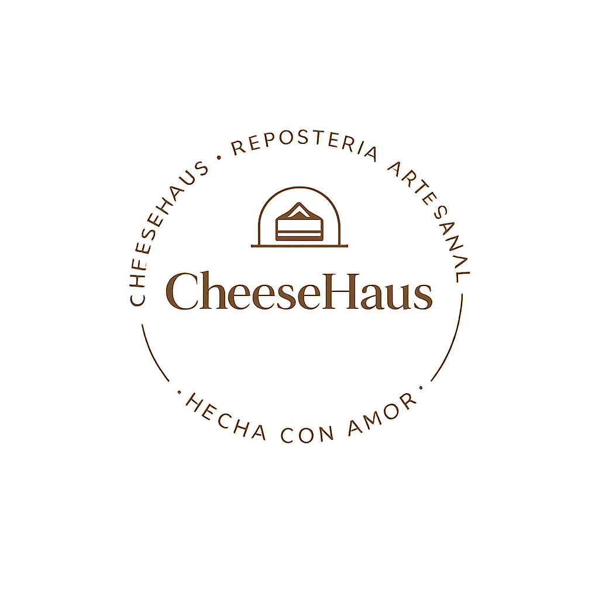

# CheeseHaus

<p align="center">
  
</p>

<p align="center">
  Una tienda en línea de postres para descubrir productos, gestionar un carrito y recorrer el proceso de compra.
</p>

## Acerca del proyecto

**CheeseHaus** es una aplicación web de comercio electrónico enfocada en postres como cheesecakes, tortas Red Velvet, brookies y brownies. El proyecto está en desarrollo y busca ofrecer una experiencia de compra clara, desde el catálogo de productos hasta la confirmación del pedido.

## Funcionalidades

- Catálogo de productos con opciones de ordenamiento.
- Vista de detalle de producto.
- Carrito de compras.
- Checkout que guarda pedidos pendientes asociados al cliente autenticado.
- Inicio de sesión tradicional y social con Google y Facebook.
- Registro con verificación de correo y recuperación de contraseña.
- Historial de pedidos del cliente autenticado.
- Secciones de inicio, productos, contacto y «Quiénes somos».
- Formulario de contacto con enlace de envío mediante WhatsApp.

> El checkout todavía no procesa pagos reales. Los pedidos se guardan con estado pendiente.

## Tecnologías

- [Next.js](https://nextjs.org/) 16 con App Router
- [React](https://react.dev/) 19 y TypeScript
- [Prisma](https://www.prisma.io/) con Neon PostgreSQL
- [NextAuth](https://next-auth.js.org/) para autenticación
- Tailwind CSS y CSS modular por página/componente
- Lucide React para iconos

## Primeros pasos

### 1. Clona el repositorio

```bash
git clone https://github.com/Jaime1603/cheeseHaus.git
cd cheeseHaus
```

### 2. Instala las dependencias

```bash
npm ci
```

### 3. Configura las variables de entorno

Crea un archivo `.env` a partir de `.env.example` y completa los valores necesarios:

```bash
cp .env.example .env
```

Completa las variables de `.env.example` en `.env`. No compartas ni subas `.env`
al repositorio. Genera un secreto aleatorio para `NEXTAUTH_SECRET` con:

```bash
node -e "console.log(require('crypto').randomBytes(32).toString('base64'))"
```

#### Acceso con Google

La persona propietaria de la cuenta del negocio debe:

1. Entrar a [Google Cloud Console](https://console.cloud.google.com/) y crear o
   seleccionar el proyecto de CheeseHaus.
2. Configurar la pantalla de consentimiento OAuth. Mientras la aplicación esté
   en modo de prueba, agregar como usuarios de prueba a las cuentas que probarán
   el acceso.
3. En **APIs y servicios → Credenciales**, crear un **ID de cliente OAuth** de
   tipo **Aplicación web**.
4. Agregar `http://localhost:3000` como origen autorizado y
   `http://localhost:3000/api/auth/callback/google` como URI de redirección
   autorizada.
5. Copiar el ID y el secreto del cliente a `GOOGLE_CLIENT_ID` y
   `GOOGLE_CLIENT_SECRET` en `.env`.

#### Acceso con Facebook

La persona propietaria de la cuenta del negocio debe:

1. Entrar a [Meta for Developers](https://developers.facebook.com/) con una
   cuenta autorizada y crear o seleccionar la aplicación de CheeseHaus.
2. Añadir y configurar el producto **Facebook Login** para web.
3. En la configuración de Facebook Login, agregar como URI OAuth de redirección
   válida `http://localhost:3000/api/auth/callback/facebook`.
4. Copiar el **App ID** y el **App Secret** a `FACEBOOK_CLIENT_ID` y
   `FACEBOOK_CLIENT_SECRET` en `.env`.
5. En modo de desarrollo, agregar las cuentas de prueba como administradores,
   desarrolladores, testers o usuarios de prueba, según las opciones de Meta.
   Para permitir acceso público, completar los requisitos de publicación,
   privacidad y revisión que indique Meta y pasar la aplicación a modo Live.

Los proveedores devuelven al sitio por estas rutas de NextAuth:
`/api/auth/callback/google` y `/api/auth/callback/facebook`. En producción, el
responsable del despliegue debe registrar también el origen HTTPS real y las
redirecciones correspondientes, por ejemplo
`https://<dominio-de-produccion>/api/auth/callback/google` y
`https://<dominio-de-produccion>/api/auth/callback/facebook`. Debe configurar
`NEXTAUTH_URL` con el origen del sitio, sin la ruta `/api/auth/callback/...`.
No uses las URLs de `localhost` en producción.

#### Envío de correo (SMTP)

Se necesita una cuenta de envío del negocio o un proveedor transaccional. La
persona propietaria debe obtener los datos SMTP y guardarlos como variables de
entorno:

```env
SMTP_HOST="servidor-smtp-del-proveedor"
SMTP_PORT="587"
SMTP_USER="usuario-smtp"
SMTP_PASSWORD="secreto-smtp"
EMAIL_FROM="CheeseHaus <remitente-autorizado@dominio.com>"
```

`EMAIL_FROM` debe ser un remitente permitido por el proveedor. Para Gmail, el
propietario debe habilitar la verificación en dos pasos y generar una
**contraseña de aplicación**; no se debe usar ni compartir la contraseña
principal de Gmail. En proveedores transaccionales, hay que verificar el dominio
y configurar los registros DNS (SPF/DKIM y, si se solicita, DMARC). En
producción, estos valores se guardan en el gestor de secretos del hosting, no en
el repositorio.

La aplicación usa `NEXTAUTH_URL` para formar los enlaces de verificación y
recuperación. En local debe ser `http://localhost:3000`; para recibir enlaces
desde otros dispositivos o usuarios se necesita un entorno de prueba o
producción accesible por HTTPS.

#### Base de datos e inicio

Confirma que `DATABASE_URL` apunta al entorno correcto. Antes de usar una base
compartida o de producción, revisa y respalda el entorno. Genera Prisma y aplica
las migraciones pendientes:

```bash
npx prisma generate
npx prisma migrate deploy
```

Después de cambiar `.env`, reinicia el servidor de desarrollo:

```bash
npm run dev
```

Verifica el flujo con cuentas de prueba controladas por el equipo: iniciar sesión
con Google y Facebook, registrar un correo al que tengan acceso, abrir el enlace
de verificación, solicitar y completar una recuperación de contraseña. El enlace
de verificación expira en 24 horas y el de recuperación en 1 hora. Si el registro
responde `503`, revisa el mensaje que muestra la página y el detalle SMTP de la
terminal; nunca compartas esas credenciales en mensajes o capturas.

Los clientes deben verificar su correo antes de iniciar sesión. La recuperación
permite cambiar la contraseña desde un enlace de un solo uso. El checkout guarda
los pedidos con estado pendiente asociados a la sesión iniciada; no procesa
pagos reales. El formulario de contacto prepara el mensaje y permite completarlo
mediante el WhatsApp de CheeseHaus.

### 4. Inicia el entorno de desarrollo

```bash
npm run dev
```

Abre [http://localhost:3000](http://localhost:3000) en el navegador.

## Estructura principal

```text
src/
├── app/          # Rutas, páginas y endpoints de la aplicación
├── components/   # Componentes reutilizables y de interfaz
├── hooks/        # Hooks personalizados
├── lib/          # Configuración de autenticación, Prisma y utilidades
└── types/        # Tipos compartidos

prisma/
└── schema.prisma # Modelo de datos y migraciones
```

## Flujo de trabajo Git

El equipo trabaja con una rama de integración y ramas de funcionalidad para mantener `main` estable.

```text
main                         → código estable y probado; no recibe cambios directos
└── develop                  → rama de integración
    ├── feature/auth         → inicio de sesión y registro
    ├── feature/productos    → catálogo y detalle de producto
    ├── feature/carrito      → carrito de compras
    ├── feature/checkout     → verificación, pago y confirmación
    ├── feature/productos-api → API y conexión a la base de datos de productos
    ├── feature/carrito-api  → lógica del carrito con Context API
    ├── feature/pedidos-api  → creación y gestión de pedidos
    └── feature/pagos-api    → integración con Wompi
```

### Reglas de integración

1. Cada integrante desarrolla su tarea únicamente en la rama asignada.
2. Los cambios se integran mediante un Pull Request desde `feature/*` hacia `develop`.
3. Antes de fusionar, el Pull Request debe revisarse y comprobarse localmente.
4. Cuando `develop` sea estable y esté probado, sus cambios se integran a `main` mediante un Pull Request.
5. No se realizan commits ni merges directos a `main`.

## Estado del proyecto

El catálogo, la autenticación, el registro verificado, la recuperación de
contraseña y el historial de pedidos están implementados. El acceso social y el
correo requieren credenciales válidas de sus proveedores. Los pagos en línea
siguen pendientes de integrar.

## Scripts disponibles

| Comando | Descripción |
| --- | --- |
| `npm run dev` | Inicia el servidor de desarrollo. |
| `npm run build` | Genera la compilación de producción. |
| `npm run start` | Ejecuta la compilación de producción. |
| `npm run lint` | Ejecuta ESLint. |

## Autoría

Proyecto desarrollado como parte del aprendizaje y práctica de desarrollo web con Next.js.
