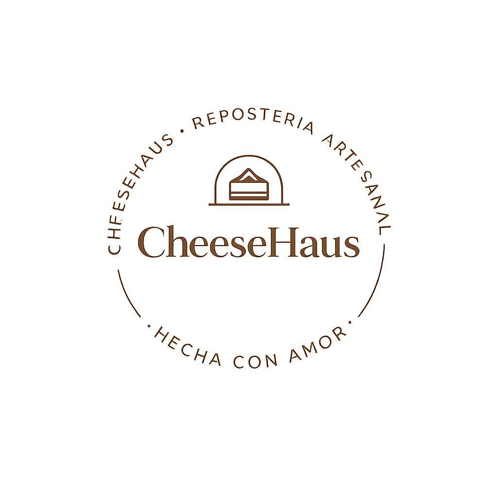

# CheeseHaus

<p align="center">
  
</p>

<p align="center">
  Una tienda en línea de postres para descubrir productos, gestionar un carrito y recorrer el proceso de compra.
</p>

## Acerca del proyecto

**CheeseHaus** es una aplicación web de comercio electrónico enfocada en postres como cheesecakes, tortas Red Velvet, brookies y brownies. El proyecto está en desarrollo y busca ofrecer una experiencia de compra clara, desde el catálogo de productos hasta la confirmación del pedido.

## Funcionalidades

- Catálogo de productos con opciones de ordenamiento.
- Vista de detalle de producto.
- Carrito de compras.
- Flujo de checkout con verificación, selección de método de pago y confirmación.
- Pantallas de inicio de sesión y registro.
- Secciones de inicio, productos, contacto y «Quiénes somos».
- Estructura preparada para autenticación y persistencia de datos.

> Algunas funciones, como la integración efectiva de pagos y ciertas rutas de API, aún están en construcción.

## Tecnologías

- [Next.js](https://nextjs.org/) 16 con App Router
- [React](https://react.dev/) 19 y TypeScript
- [Prisma](https://www.prisma.io/) con Neon PostgreSQL
- [NextAuth](https://next-auth.js.org/) para autenticación
- Tailwind CSS y CSS modular por página/componente
- Lucide React para iconos

## Primeros pasos

### 1. Clona el repositorio

```bash
git clone https://github.com/Jaime1603/cheeseHaus.git
cd cheeseHaus
```

### 2. Instala las dependencias

```bash
npm ci
```

### 3. Configura las variables de entorno

Crea un archivo `.env` a partir de `.env.example` y completa los valores necesarios:

```bash
cp .env.example .env
```

Las variables incluyen la conexión a la base de datos, configuración de NextAuth, proveedores de autenticación y claves de Wompi.

### 4. Inicia el entorno de desarrollo

```bash
npm run dev
```

Abre [http://localhost:3000](http://localhost:3000) en el navegador.

## Estructura principal

```text
src/
├── app/          # Rutas, páginas y endpoints de la aplicación
├── components/   # Componentes reutilizables y de interfaz
├── hooks/        # Hooks personalizados
├── lib/          # Configuración de autenticación, Prisma y utilidades
└── types/        # Tipos compartidos

prisma/
└── schema.prisma # Modelo de datos y migraciones
```

## Estado del proyecto

El diseño y las pantallas principales del catálogo, carrito y checkout ya están implementados. La integración de pagos, algunos endpoints y componentes reutilizables se encuentran pendientes de desarrollo.

## Scripts disponibles

| Comando | Descripción |
| --- | --- |
| `npm run dev` | Inicia el servidor de desarrollo. |
| `npm run build` | Genera la compilación de producción. |
| `npm run start` | Ejecuta la compilación de producción. |
| `npm run lint` | Ejecuta ESLint. |

## Autoría

Proyecto desarrollado como parte del aprendizaje y práctica de desarrollo web con Next.js.
